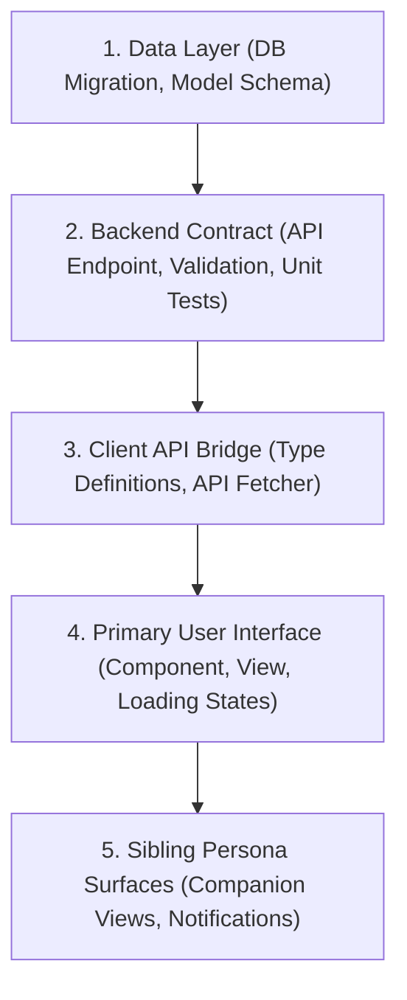

# Rule: Dependency Sequencing & Construction Order

**Category:** `00-scope-tiers`  
**Priority:** Critical (Bottom-Up Construction Standard)

---

## 1. Mandatory 5-Stage Construction Sequence

* Binding client UI buttons to database state before migrations and API endpoints are implemented and verified is STRICTLY PROHIBITED.
