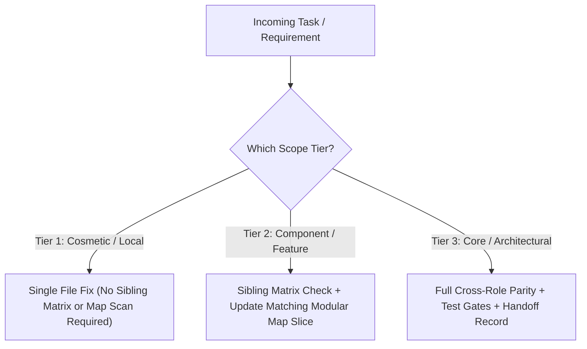

# Playbook: Scope Tiers & Change Classification

**Directory:** `rules/00-scope-tiers/change-classification.md`  
**Objective:** Prevent ceremonial token bloat on trivial edits by classifying all tasks into 3 explicit operational tiers.

---

## 1. Change Classification Flowchart

---

## 2. Definitions and Execution Invariants

### Tier 1: Cosmetic and Local Edits (Cosmetic / Local Fixes)
* **Scope:** {{TIER_1_EXAMPLES}}
* **Execution Rule:**
  * Modify only the target file.
  * No need to scan sibling files or update modular maps.
  * Run quick build/syntax check and yield.
* **Token Efficiency:** Maximum savings (zero ancillary context loaded).

### Tier 2: Component and Feature Updates (Component / Feature Level)
* **Scope:** {{TIER_2_EXAMPLES}}
* **Execution Rule:**
  * Consult `rules/02-impact-analysis-and-parity/sibling-pairs-matrix.md` and check companion files.
  * Update the relevant modular map slice under `maps/`.
  * Run component/contract verification tests.

### Tier 3: Core and Platform Invariants (Core / Platform Invariants)
* **Scope:** {{TIER_3_EXAMPLES}}
* **Execution Rule:**
  * Enforce complete cross-role parity across all client personas and backend tiers.
  * Execute all Mandatory Quality Verification Gates.
  * Update `docs/handoff/WHERE_WE_LEFT_OFF.md`.
  * Emit the Mandatory Compliance Ledger table at the end of the response.
