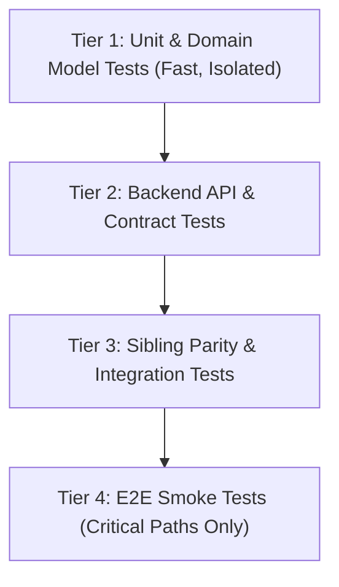

# Canonical Recipe: The 4-Tier Test Pyramid & Quality Gate

**Category:** `04-canonical-recipes`  
**Purpose:** Enforce deterministic automated test construction for every new feature or data mutation, eliminating untested code paths.

---

## 1. Test Pyramid Tiers for {{PROJECT_NAME}}

---

## 2. Mandatory Test Deliverables per Scope Tier

| Scope Tier | Required Test Level | Test Framework / Command | Passing Threshold |
|---|---|---|---|
| **Tier 1 (Cosmetic / Typo)** | Local static check / lint | `{{LINT_COMMAND}}` | 0 errors |
| **Tier 2 (Component / Feature)** | Unit test + Component test | `{{UNIT_TEST_COMMAND}}` | 100% pass on modified files |
| **Tier 3 (Core / Schema / AuthZ)** | Contract + Integration + Sibling check | `{{INTEGRATION_TEST_COMMAND}}` | 100% pass + clean migration rollback |

---

## 3. Canonical Recipe Steps for New Feature Testing

1. **Step 1 (Contract Test):** Before writing UI, write an API test asserting expected request validation, 200 OK, 400 Bad Request, and 403 Forbidden scenarios.
2. **Step 2 (Unit / Entity Test):** Test domain logic and edge cases in isolation (boundary numbers, nulls, date transitions).
3. **Step 3 (Sibling Test):** Assert that a mutation executed by Role A is visible or correctly restricted in Role B's query/view.
4. **Step 4 (Smoke Run):** Execute `{{PROJECT_VERIFICATION_COMMANDS}}` and ensure exit code 0 before declaring task completion.
