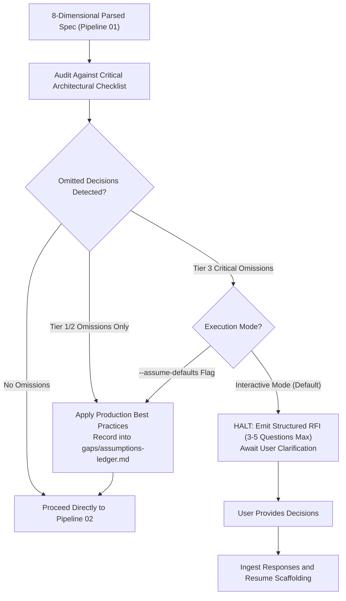

# Pipeline 01b: Pre-Flight Completeness Gate & Architectural RFI Engine
*(Specification Ambiguity Audit and Architectural Request for Information Engine)*

**Directory:** `SpecOS/core-engine/01b-plan-completeness-gate.md`  
**Input:** 8-dimensional architecture summary from `01-plan-deconstructor.md`  
**Output:** Clarifying RFI queries (HALT) OR Populated `gaps/assumptions-ledger.md` (PROCEED)

---

## 1. Why Pre-Flight Auditing is Mandatory

When an architecture plan or PRD is ambiguous or omits foundational decisions, generating code or maps based on silent model guesses introduces severe architectural risk. An incorrect assumption regarding tenancy, soft-deletion, or authorization propagates across dozens of contracts, maps, and migrations.

This engine enforces a **pre-flight completeness audit** prior to modular map scaffolding and contract generation:



---

## 2. Strict Criticality Filter (When in Doubt, DO NOT ASK)

To prevent analysis paralysis and avoid interrupting the user with trivial questions, the engine enforces an ultra-strict threshold: **an RFI question may ONLY be issued if an omitted decision satisfies all 3 criteria simultaneously:**

1. **Irreversible Migration Cost:** Reversing the decision later requires a ground-up rewrite of database schemas, tenant isolation boundaries, or security architecture.
2. **Zero Contextual Clues:** The provided plan gives no obvious hints, precedents, or domain conventions to deduce the answer safely.
3. **Direct Data Loss or Compliance Risk:** An incorrect assumption would cause unrecoverable data loss, accounting violations, or critical security vulnerabilities.

### Strict Prohibitions: Questions NEVER Permitted
The engine is **strictly forbidden** from halting or questioning the user about:
* **UI & Presentation:** Colors, layout grids, icon libraries, modal animation styles, or CSS frameworks.
* **Standard API Conventions:** HTTP status codes, standard pagination limits, endpoint naming casing (snake_case vs camelCase).
* **Secondary Tooling:** Specific testing runner (Vitest vs Jest) if compatible, minor utility libraries.
* **Reversible Refactors:** Any decision that can be changed later in under 10 minutes via `RE-TRIGGER.md` or a standard patch.

**Rule:** All non-critical omissions must automatically adopt industry best practices and be silently logged into `gaps/assumptions-ledger.md`.

---

## 3. The 4 True Critical Blockers (Hard Cap: Max 1–3 Questions)

Only the following 4 foundational forks qualify for an RFI, capped at a strict maximum of **3 questions total**:
1. **Multi-Tenancy Isolation Model:** Single DB with `tenant_id` column vs. Schema-per-tenant vs. Isolated DB-per-tenant (irreversible migration cost).
2. **Data Retention & Audit Disciplinary Model:** Soft-delete (`deleted_at`) vs. Permanent CASCADE deletion for legal/financial entities (data loss risk).
3. **Incompatible Database Engine:** Ambiguity where the spec conflicts between Relational (PostgreSQL) vs Document (MongoDB) vs Embedded (SQLite).
4. **Irreversible Permission Fork:** Direct execution of high-risk actions (e.g., instant financial payout or permanent account purge) without secondary approval.

## 4. RFI (Request for Information) Output Standard

When Tier 3 omissions occur in Interactive Mode, the engine halts execution and outputs a structured RFI following this exact format:

```text
[PRE-FLIGHT AUDIT: ARCHITECTURAL CLARIFICATIONS REQUIRED]

The provided architecture specification leaves foundational architectural decisions unspecified.
To scaffold ex_specos without incorrect assumptions, please clarify the following items:

1. Multi-Tenancy Model:
   - [A] Shared database with tenant_id filter (Recommended for fast MVP & cost efficiency)
   - [B] Schema-per-tenant (PostgreSQL schemas for enterprise data segregation)
   - [C] Separate database per tenant

2. Data Deletion Policy:
   - [A] Soft-delete (deleted_at timestamp, records preserved for audit/recovery) (Recommended)
   - [B] Hard delete (permanent CASCADE purge)

Please respond with your selections (e.g. "1-A, 2-A" or provide custom requirements).
Alternatively, re-run with "--assume-defaults" to adopt recommended best practices automatically.
```

---

## 5. Resumption Workflow

Once the user provides responses:
1. The answers are bound into the system context.
2. Decisions are logged in `gaps/assumptions-ledger.md` with `Status: Confirmed by User`.
3. The engine immediately resumes Pass 2 (`02-sibling-matrix-deriver.md`).
