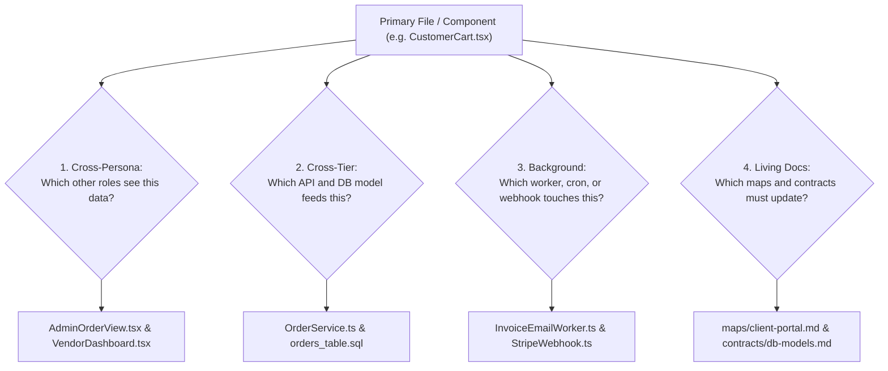

# Pipeline 02: The Sibling Matrix Deriver
*(Cross-Role & Dependency Derivation Engine)*

**Directory:** `SpecOS/core-engine/02-sibling-matrix-deriver.md`  
**Input:** Roles, tiers, and data mutation chains extracted by `01-plan-deconstructor.md`  
**Output:** Project-specific `rules/02-impact-analysis-and-parity/sibling-pairs-matrix.md`

---

## 1. Sibling Derivation Algorithm

To prevent isolated, single-silo modifications and cross-service regressions during implementation, this pipeline evaluates 4 cross-cutting questions:

### Question 1: Cross-Persona Sibling Derivation
* *"When User Role A creates, updates, or deletes this data, which components in User Role B and User Role C are affected?"*
* **Derived Dependency:**  
  `CustomerCheckout.tsx` $\leftrightarrow$ `AdminOrderTable.tsx` $\leftrightarrow$ `WarehousePackingView.tsx`

### Question 2: Cross-Tier Sibling Derivation
* *"Which backend API endpoint and database model are strictly bound to this frontend component?"*
* **Derived Dependency:**  
  `UserProfileCard.tsx` $\leftrightarrow$ `api/v1/users/profile.ts` $\leftrightarrow$ `models/User.ts` $\leftrightarrow$ `migrations/001_users.sql`

### Question 3: Event & Background Worker Sibling Derivation
* *"Is there a scheduled cron job, email worker, or payment webhook listening to this database state?"*
* **Derived Dependency:**  
  `SubscriptionStatus` $\leftrightarrow$ `workers/daily_billing_cron.ts` $\leftrightarrow$ `webhooks/stripe_handler.ts`

---

## 2. Target Project Sibling Table Output

This pipeline produces a concrete matrix table:

| Primary File / Feature | Persona A Surface | Persona B Surface (Admin/Staff) | Backend & DB Siblings | Mandatory Living Map File |
|---|---|---|---|---|
| `[FeatureName]` | `[ClientFile.tsx]` | `[AdminFile.tsx]` | `[Service.ts]` & `[Model.sql]` | `maps/01-...md` & `contracts/...md` |

This generated table is installed into `ex_specos` under `rules/02-impact-analysis-and-parity/sibling-pairs-matrix.md`.
