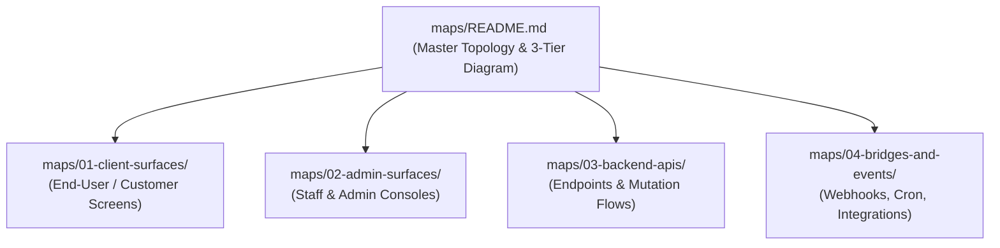
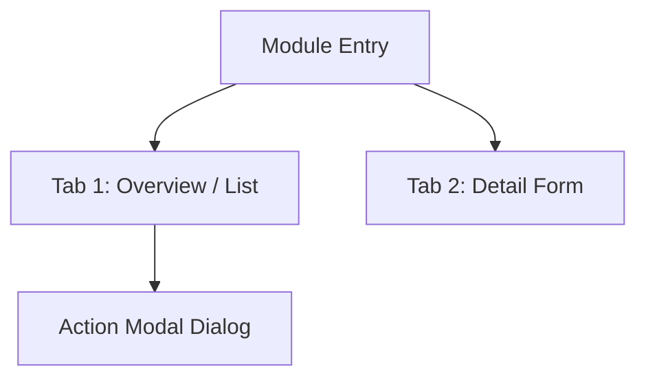

# Pipeline 03: The Modular Map Scaffolder
*(Modular Living Atlas Scaffolding Engine)*

**Directory:** `SpecOS/core-engine/03-modular-map-scaffolder.md`  
**Input:** Tiers, views, and components identified by `01-plan-deconstructor.md`  
**Output:** Populated `maps/` directory with `<3 KB` modular living map slices

---

## 1. Modular Mapping Standard (Why and How)

Monolithic documentation files (`50 KB+`) quickly become stale and waste thousands of tokens per prompt turn. This engine splits the target system's atlas into **tight modular slices, each strictly capped at <3 KB (~500-700 tokens)**:

---

## 2. Standard Anatomy of Every Map Slice

Every generated file under `maps/**/*.md` MUST include these 3 standardized sections:

### Section 1: Module Flow & Hierarchy (Mermaid)
Models internal component routing, views, or tabs via ASCII/Mermaid:

### Section 2: Layout Containers & Component Inventory
A structured table detailing all actionable or interactive elements:
* **Frame / Section:** Header, Hero banner, Data Grid, Sidebar, etc.
* **Visual Elements:** StatCards, Status Badges, Charts, CountUp metrics.
* **Buttons & Triggers:** CTA buttons, filter pills, 3-dot dropdown items.
* **Destination Modals / Routes:** Target modal dialogs or sub-routes.

### Section 3: Role Boundaries & Permissions
* Which user roles can access this surface?
* Which actions are `disabled`, `hidden`, or rendered read-only per persona?

---

## 3. Master Atlas Index (`maps/README.md`)

A top-level master index file is generated linking all slices and presenting a unified high-level architectural overview.
