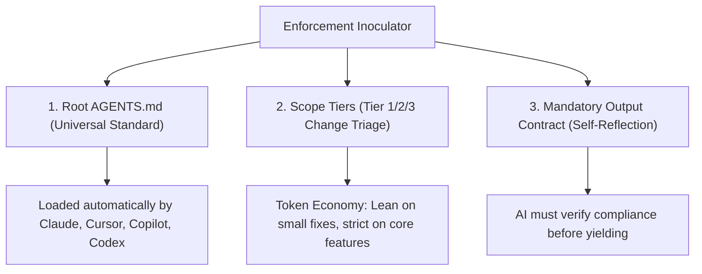

# Pipeline 05: The Enforcement & Quality Gates Configurator
*(Repository Rules and Verification Gate Engine)*

**Directory:** `SpecOS/core-engine/05-enforcement-inoculator.md`  
**Input:** Universal AAIF standard and project-specific quality requirements  
**Output:** Root `AGENTS.md`, `rules/00-scope-tiers/`, and `rules/05-quality-gates-and-verification/`

---

## 1. The 3 Pillars of Architecture Enforcement

This engine configures `ex_specos` with **3 active guardrail mechanisms** ensuring architectural compliance across changes:



---

## 2. Inoculated Guardrail Mechanisms

### A. Root `AGENTS.md` File
* Placed at the exact repository root per the Agentic AI Foundation (`AGENTS.md`) open standard.
* Defines the project's unique system code name (e.g. `ex_specos`) and declares it **100% active by default on every single prompt turn**.
* Directly wires links to `maps/`, `rules/`, `contracts/`, and `recipes/`.

### B. Scope Tiers Playbook (`rules/00-scope-tiers/`)
Triages tasks into 3 tiers to balance verification depth against change blast radius:
* **Tier 1 (Cosmetic / Local):** CSS, typo fixes $\rightarrow$ Touch single file; no sibling check needed.
* **Tier 2 (Component / Feature):** New modal, form revision $\rightarrow$ Sibling matrix scan + update matching `maps/` slice.
* **Tier 3 (Core / Platform):** API schema, database, role permission boundaries $\rightarrow$ Full cross-role parity check + verification gates + handoff log.

### C. Verification & Compliance Ledger (`rules/05-.../mandatory-output-contract.md`)
Requires an explicit compliance audit table to be evaluated upon task completion:
```markdown
### Architecture & Verification Compliance Ledger
| Audit Item | Status | Inspected / Synchronized Files |
|---|:---:|---|
| Sibling Files & Role Parity | [OK] / [N/A] | ... |
| Architecture Maps (maps/) | [OK] / [N/A] | ... |
| Interface Contracts (contracts/) | [OK] / [N/A] | ... |
| Quality Verification Gates | [OK] | ... |
| Working Tree Status | [OK] | git status clean |
```
This audit table enforces structured verification across all touched layers prior to delivery.

### D. Deterministic Mechanical Verification (`tools/verify-system.mjs`)
To eliminate the "Self-Reporting Fallacy" (where AI claims everything passed without running checks):
* Installs `tools/verify-system.mjs` into the project root.
* Configures `.git/hooks/pre-commit` using `blueprints/pre-commit-hook.blueprint.sh`.
* The pre-commit hook automatically blocks any commit where sibling files were missed or markdown map links are broken.
