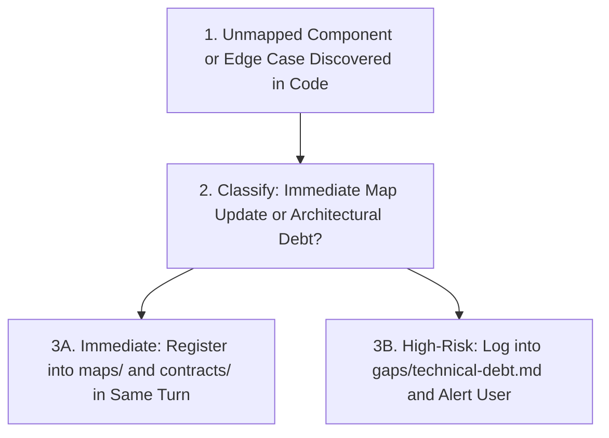

# Pipeline 06: In-Flight Gap & Technical Debt Backfiller
*(Technical Debt Capture and Architecture Synchronization Engine)*

**Directory:** `SpecOS/core-engine/06-organic-gap-filler.md`  
**Input:** Unmapped components, schema gaps, or unforeseen edge cases discovered during coding  
**Output:** Populated `gaps/` ledger and real-time living map backfilling

---

## 1. Core Principle and Objective

During implementation, developers and automated tools encounter components, schema columns, or edge cases not anticipated in the initial plan:
* An unmapped legacy helper function (`formatDate.ts`),
* An unrecorded foreign key column (`tenant_id`),
* An external API rate limit or validation edge case.

This engine ensures every newly discovered item is either synchronized into `maps/` and `contracts/` in the same change set, or logged into `gaps/technical-debt.md`.
---

## 2. Mandatory 3-Step Gap-Filling Protocol

### Step 1: Immediate Living Map Backfilling
* If the discovered item is a missing UI button, sub-component, or parameter, the AI must append it to the corresponding `maps/` slice **in the exact same prompt turn** that wrote the code.

### Step 2: Immediate Contract Registration
* If a new table column or endpoint parameter was introduced, a row must be added to the appropriate file in `rules/contracts/`.

### Step 3: Technical Debt Ledger (`gaps/technical-debt.md`)
* If the discovered gap cannot be resolved immediately without a risky refactor (e.g. an insecure dependency or deprecated library), the AI logs it in `gaps/technical-debt.md`:
  * **Gap ID:** `GAP-001`
  * **Location:** File path and component.
  * **Risk:** Potential consequence or security exposure.
  * **Proposed Fix:** Actionable plan for a future milestone.
