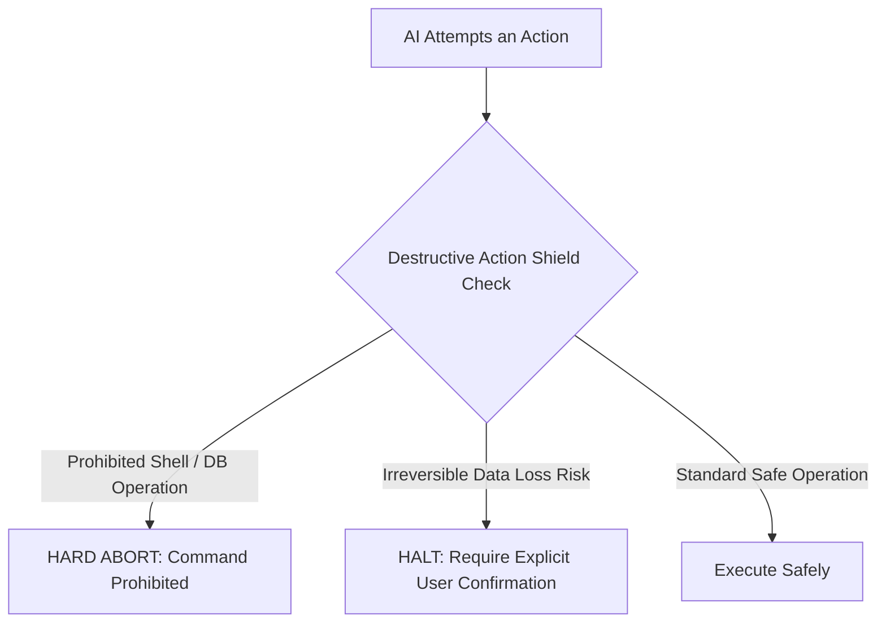

# Pipeline 07: The Destructive Action Shield
*(Disaster Prevention & Destructive Action Shield Engine)*

**Directory:** `SpecOS/core-engine/07-destructive-action-shield.md`  
**Input:** High-risk shell commands, raw database operations, and schema mutations  
**Output:** Inoculated `rules/03-owner-preferences-and-invariants/destructive-shield.md`

---

## 1. Why is this Required?

AI models during aggressive refactoring or debugging can execute catastrophic operations:
* Dropping database tables (`DROP TABLE`),
* Recursively deleting directory trees (`rm -rf`),
* Embedding live production secrets in client-side bundles,
* Bypassing migration tools and corrupting schema version tracking.

This engine configures strict safety guardrails in `ex_specos`.

---

## 2. The 4 Firewalls of the Shield

1. **Prohibited Shell Commands:**
   * Root deletions (`rm -rf /`, `rm -rf *`),
   * Deleting core configuration files,
   * Executing unverified external binaries.
2. **Prohibited Database Operations:**
   * `DROP DATABASE`, unconfirmed `DROP TABLE`,
   * Unfiltered `DELETE FROM` or `TRUNCATE TABLE`,
   * Executing raw DDL in production without going through the migration framework.
3. **Data Loss & Privacy Guardrail:**
   * Hard deleting user records without soft-delete flags is strictly forbidden unless the user prompt explicitly requests a permanent purge.
4. **Recovery Prerequisite:**
   * Before executing any potentially risky operation, verify that a clean rollback path exists (`rules/recipes/how-to-rollback-safely.md`).
