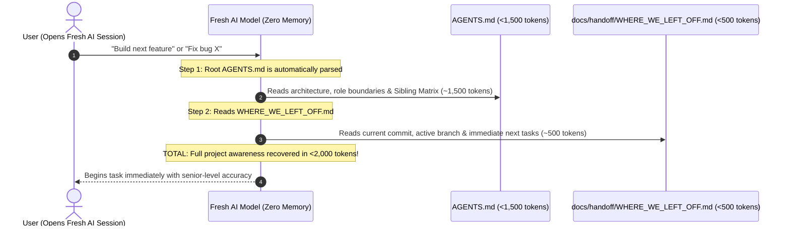

# Pipeline 08: The Zero-Session Fast Bootloader
*(Zero-Session Context Recovery Engine)*

**Directory:** `SpecOS/core-engine/08-session-bootstrap-engine.md`  
**Input:** Fresh AI session with zero prior conversation history  
**Output:** 100% Context Recovery in <2,000 Tokens

---

## 1. The Problem: AI Context Amnesia

In AI development workflows, users frequently start new chat sessions or clear the context window. When a fresh AI model enters a repository and attempts to scan hundreds of source files:
* It wastes 50,000+ tokens on initial exploration,
* It clutters its context window with implementation details,
* It risks misinterpreting active architectural rules.

This engine injects a **2-step rapid bootloader protocol** into `ex_specos`:

---

## 2. The 2-Step Fast Bootloader Protocol

1. **Step 1: Root Invariants Anchor (`AGENTS.md`):**  
   The AI ingests the multi-tier architecture, role boundaries, sibling matrix, and output contract in a single read (~1,500 tokens).
2. **Step 2: Living State Anchor (`WHERE_WE_LEFT_OFF.md`):**  
   The latest commit, verified test gates, active branch, and immediate next actions (~500 tokens).
3. **Result:** Fast project awareness in <2,000 tokens, eliminating exploratory file scanning overhead.
