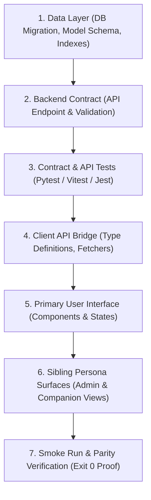

# Pipeline 09: The Dependency & Migration Sequencer
*(Execution Ordering and Dependency Sequencing Engine)*

**Directory:** `SpecOS/core-engine/09-dependency-sequencer.md`  
**Input:** New feature specification or data model change  
**Output:** Strict bottom-up execution order enforced in `ex_specos`

---

## 1. Why is this Required?

AI models frequently write code in **reverse order**:
* They build UI buttons and complex client views before the database migration has been run or the backend API exists.
* This leads to "phantom data", broken types, unhandled network failures, and runtime crashes.

This engine enforces a strict **"Bottom-Up Construction Sequence"** into `ex_specos`.

---

## 2. Mandatory 7-Step Order of Operations (Test-Inoculated)

1. **Step 1 (Data Layer):** Database schema migrations must be written and verified before backend endpoints are coded.
2. **Step 2 (Backend Contract):** The API route must be implemented and validated against input schemas.
3. **Step 3 (Contract & API Tests):** Automated tests asserting 200 OK, 400 validation error, and 403 authorization boundary MUST pass before client code is written.
4. **Step 4 (Client Bridge):** TypeScript types and API client functions must be defined before UI state binds to them.
5. **Step 5 (Primary UI):** The primary view is built with explicit loading, empty, and error fallback states.
6. **Step 6 (Sibling Views):** All companion persona views mapped in `sibling-pairs-matrix.md` are updated in lockstep.
7. **Step 7 (Smoke Run):** Verification commands (`tools/verify-system.mjs`, test suites) execute with exit code 0.
