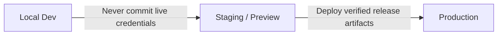

# Pipeline 10: The Environment Parity Guard
*(Environment Isolation and Deployment Security Engine)*

**Directory:** `SpecOS/core-engine/10-environment-parity-guard.md`  
**Input:** Target project runtime environments (Local Dev, Staging, Production)  
**Output:** Inoculated `rules/03-owner-preferences-and-invariants/environment-parity.md`

---

## 1. Why is this Required?

In multi-tier software, the local development environment (Docker, SQLite, mock payment gateway, Mailpit) differs significantly from production (PostgreSQL, live Stripe/PayTR, real SMTP).

AI models frequently make dangerous mistakes:
* Leaking local fake/mock implementations into production bundles,
* Hardcoding live API keys or production database credentials in client code,
* Assuming a local shortcut works on managed production hosting.

This engine configures strict **Environment Isolation Guardrails** in `ex_specos`.

---

## 2. 3-Tier Environment Isolation Matrix

| Environment | Database Invariants | External Services & Mail | Secrets & Keys |
|---|---|---|---|
| **Local Dev** | Local SQLite / Docker DB. Arbitrary test seeds permitted. | Mock providers, Mailpit local mail catcher. | `.env` file (git-ignored). |
| **Staging** | Isolated staging DB. Zero live user PII. | Sandbox API keys (Stripe/PayPal Test). | Staging environment variables. |
| **Production** | Strict migration discipline. Hard resets forbidden. | Live gateways, verified domain SMTP. | Managed vault / host environment variables. NEVER in source code! |

---

## 3. Mandatory Invariants
1. Production API credentials and database passwords must NEVER be committed to Git.
2. Development mock logic must NEVER leak into production builds (`NODE_ENV === 'production'` guards).
