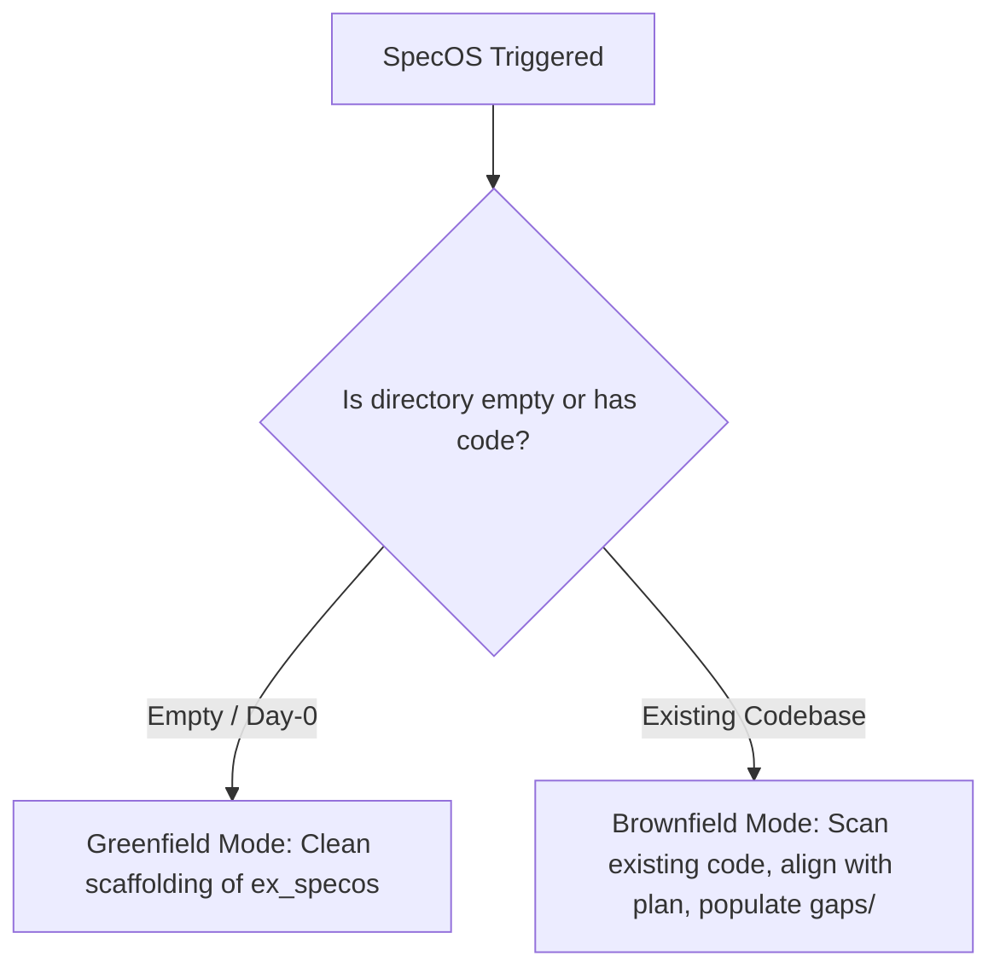

# Pipeline 11: The Greenfield & Brownfield Dual Adapter
*(Dual Adaptation Engine for Fresh and Existing Repositories)*

**Directory:** `SpecOS/core-engine/11-brownfield-greenfield-adapter.md`  
**Objective:** Ensure `SpecOS` operates flawlessly both in brand new empty directories (Day-0 Greenfield) and in large legacy repositories with 50,000+ existing lines of code (Brownfield Retrofit).

---

## 1. Automatic Project State Detection

When triggered, the AI inspects the working directory before scaffolding:

### Mode A: Greenfield (Brand New Project — Day-0)
* No existing application code present.
* `maps/` is generated entirely from the planned architecture.
* `contracts/` is seeded from the planned data models.

### Mode B: Brownfield (Existing Project — Retrofit)
* Substantial existing code already exists.
* The AI scans the existing directory tree (`find`, `ls`) and reconciles existing files against the plan.
* Existing files not in the plan are logged under `gaps/unmapped-existing-code.md`.
* The modular `maps/` atlas is wrapped over existing code without deleting or corrupting any source files.
