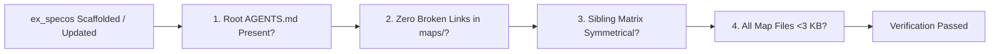

# Pipeline 12: Autonomous System Integrity Verifier
*(Autonomous Health Verification & Self-Test Engine)*

**Directory:** `SpecOS/core-engine/12-system-integrity-verifier.md`  
**Objective:** Execute an autonomous self-test immediately after `ex_specos` is scaffolded or re-triggered, verifying structural completeness before delivery.

---

## 1. 4-Stage Autonomous Sanity Check

Before declaring scaffolding complete, the system runs 4 automated validation checks:

1. **Root Entrypoint Check:** Verify `AGENTS.md` is present at the repository root and has the system code registered.
2. **Broken Link Scan:** Verify every relative markdown link in `maps/README.md` points to a real file on disk.
3. **Sibling Matrix Symmetry:** Verify that for every A $\rightarrow$ B mapping in `sibling-pairs-matrix.md`, both components exist and are mapped.
4. **Token Budget Enforcement:** Verify that no individual modular map slice exceeds the strict `<3 KB` token limit (split oversized slices immediately).
