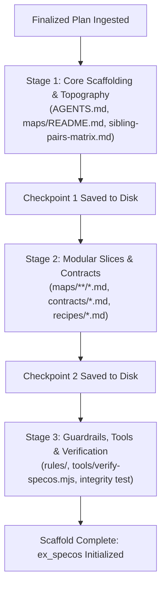

# Pipeline 13: The Multi-Stage Checkpointed Orchestrator
*(Staged Ignition & Output Token Overflow Prevention Engine)*

**Directory:** `SpecOS/core-engine/13-multi-stage-orchestrator.md`  
**Input:** Large-scale architecture plan exceeding single-turn output budget  
**Output:** Chunked sequential scaffolding execution with persistent state checkpoints
---

## 1. Why Staged Orchestration is Required

In enterprise systems with 15+ views and 30+ endpoints, forcing an AI model to scaffold the entire architecture in a single prompt turn results in:
* **Output Truncation:** Model hits the hard token limit (4k/8k/16k) and cuts off mid-file.
* **Degraded Scaffolding:** Model skips details, writing generic placeholders instead of complete Mermaid diagrams.

This engine converts the ignition process into **3 discrete checkpoints with persistent disk sync**:

---

## 2. The 3 Checkpoint Stages

### Stage 1: Core Scaffolding & Topography
* Executes `01-plan-deconstructor.md` and `02-sibling-matrix-deriver.md`.
* Generates root `AGENTS.md`, master `maps/README.md`, and `sibling-pairs-matrix.md`.
* Writes to disk immediately. Output footprint: ~2,500 tokens.

### Stage 2: Modular Slices, Contracts & Recipes
* Executes `03-modular-map-scaffolder.md` and `04-contracts-and-recipes-generator.md`.
* Generates all `<3 KB` individual slice files under `maps/` and compact schemas under `rules/contracts/`.
* Writes to disk immediately. Output footprint: ~3,000 tokens per batch.

### Stage 3: Guardrails, Deterministic Tools & Verification
* Executes `05-enforcement-inoculator.md`, `07`, `09`, `10`, and `12-system-integrity-verifier.md`.
* Installs `tools/verify-specos.mjs` and git pre-commit hook.
* Runs static verification tests and outputs initialization report. Output footprint: ~1,500 tokens.
---

## 3. Autonomous Continuation Rule
If the AI agent harness supports sequential tool calls (e.g. Claude Code, OMP, OpenCode), it executes Stage 1, Stage 2, and Stage 3 automatically in order, verifying disk writes between stages.
