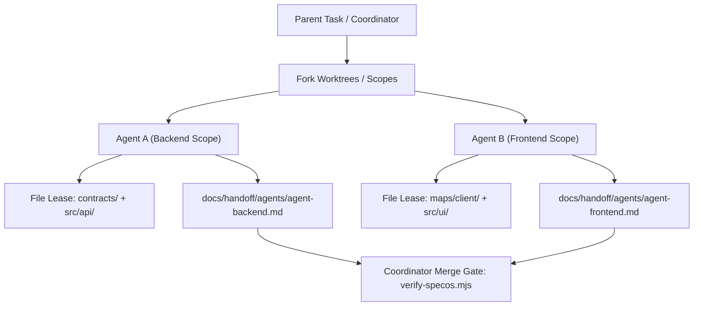

# Pipeline 14: The Agent Concurrency & Worktree Manager
*(Multi-Agent Swarm Coordination & Lock Protocol Engine)*

**Directory:** `SpecOS/core-engine/14-agent-concurrency-manager.md`  
**Input:** Multi-agent concurrent execution environment (OMP subagents, swarm workers)  
**Output:** Partitioned handoff states and collision-free file lease protocol

---

## 1. Concurrency Problem in Agent Swarms

When multiple subagents operate in parallel inside the same project repository:
1. **Handoff Collision:** Two agents simultaneously overwrite `WHERE_WE_LEFT_OFF.md`.
2. **Sibling Conflict:** Agent A refactors backend API while Agent B refactors UI without knowing Agent A's transient changes.
3. **Dirty Git State:** Staged commits from Agent A accidentally absorb unfinished files from Agent B.

---

## 2. The 3 Isolation Firewalls

### Firewall 1: Partitioned Living State (`docs/handoff/agents/`)
* Instead of a single monolithic `WHERE_WE_LEFT_OFF.md`, active parallel subagents write their progress to dedicated partitions:
  `docs/handoff/agents/<agent-name>.md`
* The parent coordinator merges completed subagent notes into the master `WHERE_WE_LEFT_OFF.md` upon job settlement.

### Firewall 2: Sibling Domain Leases (Scoped Ownership)
* An agent MUST claim ownership of a specific modular domain before editing:
  - Agent 1: Owns `maps/03-backend-apis/` and `src/api/`
  - Agent 2: Owns `maps/01-client-surfaces/` and `src/views/`
* Crossing boundaries requires inter-agent message passing or staging in `gaps/in-flight/`.

### Firewall 3: Git Worktree Isolation
* When parallel destructive changes are required, subagents MUST run in isolated git worktrees (`git worktree add ../wt-feature-branch`), running `tools/verify-specos.mjs` before merging back into main.
