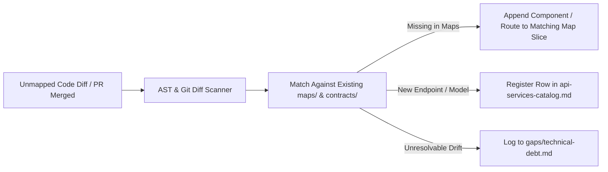

# Pipeline 15: The Reverse-Sync & Drift Reconciliation Engine
*(Code-to-Map Reverse Synchronization and Human Drift Engine)*

**Directory:** `SpecOS/core-engine/15-reverse-sync-engine.md`  
**Input:** Codebase AST, git commit diffs, or newly added human endpoints/models  
**Output:** Synchronized `maps/` and `contracts/` with zero human drift

---

## 1. Why Reverse Sync is Required

Software is not only written by AI. Human developers, external pull requests, and emergency hotfixes frequently touch the codebase directly without updating markdown maps.
When this occurs, `<project>_specos` maps become stale ("Doc Drift").

This engine provides the **reverse flow: Code $\rightarrow$ Maps & Contracts**.

---

## 2. Reverse Sync Execution Protocol

### Step 1: Endpoint & Model Discovery
Scan modified source code:
* Fast scan for HTTP route decorators (`@Get`, `@Post`, `app.get`, `router.post`, `Route::`).
* Scan for ORM model definitions (`@Entity`, Prisma schema, SQLAlchemy, ActiveRecord).

### Step 2: Living Document Reconciliation
* If route `POST /api/v2/webhooks/paytr` is present in code but absent from `contracts/api-services-catalog.md`, append the row immediately.
* If a new UI screen or modal is added in source code, append the frame to the corresponding `maps/` slice.

### Step 3: Verification
* Run `node tools/verify-specos.mjs verify-contracts` to ensure parity returns to 100%.
