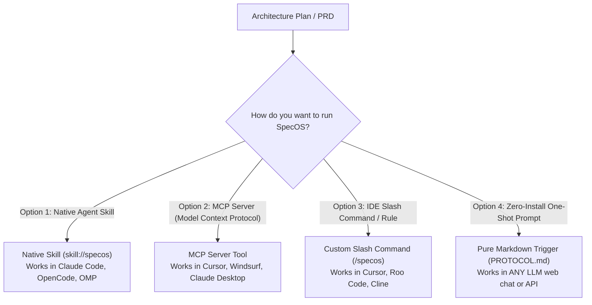

# Guide: How to Run and Integrate `SpecOS` Across AI Tools & Agents
*(Skills, MCP, Slash Commands & System Prompts Integration Guide)*

**Directory:** `SpecOS/docs/how-to-use-and-integrate.md`  
**Audience:** Developers, Architects, and AI Assistants

This comprehensive guide explains the **4 best ways to run `SpecOS`** across different engineering tools and agent harnesses—ranging from **Native Skills** to **MCP Servers**, **IDE Slash Commands**, and **Portable Prompts**.

---

## Overview of Integration Methods



---

## Option 1: Running as a Native AI Agent Skill (Recommended)

Modern agentic harnesses (including Claude Code, OMP, OpenCode, and AAIF-compliant tools) support the **Agent Skill Standard** (`SKILL.md`).

### Where It Lives:
`SpecOS/skills/skill-specos/SKILL.md`

### How to Install:
* **Global Installation:** Copy `SpecOS/skills/skill-specos/` to your agent's global skills directory (e.g. `~/.omp/skills/specos/` or `~/.claude/skills/specos/`).
* **Project Installation:** Keep it inside the target project under `.agent/skills/specos/`.

### How to Trigger:
Prompt the agent:
```text
# Interactive Mode (Asks 1-3 RFI questions if Tier 3 decisions are omitted):
Here is my architecture specification: [PASTE PLAN]. Use skill:specos to scaffold ex_specos.

# Autonomous Mode (Auto-adopts best-practice defaults and logs to gaps/assumptions-ledger.md):
Here is my architecture specification: [PASTE PLAN]. Use skill:specos to scaffold ex_specos with --assume-defaults.
```
The agent loads the skill definition, executes the synthesis passes sequentially, validates integrity via `tools/verify-specos.mjs`, and outputs the scaffolding summary.

---

## Option 2: Running via Model Context Protocol (MCP) (Optional Bridge)

If you use **Claude Desktop, Cursor, Windsurf, or Zed**, you can expose `SpecOS` verification scripts or custom runners through an MCP server bridge.

*(Note: The core engine is zero-dependency markdown & CLI. If you build an MCP wrapper for your local environment, configure it as follows):*

### Example MCP Configuration (`mcp.json` or `claude_desktop_config.json`):
```json
{
  "mcpServers": {
    "specos": {
      "command": "node",
      "args": ["/path/to/your-mcp-wrapper/index.js"]
    }
  }
}
```
### Exposed MCP Tools:
1. `specos_scaffold`: Takes `{ plan_text, project_root, assume_defaults }` and scaffolds `<project>_specos`.
2. `specos_retrigger`: Takes `{ plan_delta, project_root }` and performs a non-destructive delta re-seed.
3. `specos_reverse_sync`: Reconciles `maps/` and `contracts/` with recent code changes / PRs.
4. `specos_deprecate`: Safely prunes retired endpoints, dead code, and obsolete map slices.
5. `specos_verify`: Executes `tools/verify-specos.mjs` to audit link integrity, slice budgets, and sibling parity.

### Direct CLI Usage:
Target projects can run verification at any time:
```bash
node tools/verify-specos.mjs all                # Runs full integrity audit
node tools/verify-specos.mjs verify-maps        # Audits link validity & <3 KB slice budget
node tools/verify-specos.mjs verify-siblings    # Checks staged git files against sibling matrix
node tools/verify-specos.mjs verify-assumptions # Verifies assumptions ledger for unconfirmed blockers
```

---

## 3. Option 3: Running as an IDE Slash Command (Cursor / Windsurf / Cline)

In tools like **Cursor AI**, **Windsurf**, or **Roo Code**, you can map `SpecOS` to a custom slash command.

### In Cursor (`.cursor/rules/specos.mdc` or User Prompts):
Create a file `.cursor/rules/specos.mdc`:
```markdown
---
description: Trigger SpecOS to scaffold project rules and maps from a specification
globs: *
---
When the user says `/specos` or provides a plan:
1. Read `SpecOS/PROTOCOL.md`.
2. Parse the plan into roles, tiers, and data flows using `core-engine/`.
3. Scaffold `maps/`, `rules/`, `contracts/`, and `AGENTS.md`.
4. Run static integrity verification via `node tools/verify-specos.mjs all`.
```

### How to Trigger:
In Cursor Composer or Chat, simply type:
```text
/specos
[PASTE YOUR ARCHITECTURE PLAN HERE]
```

---

## Option 4: Zero-Install Portable Prompt (Universal / Web Chat)

If you are using ChatGPT, Claude.ai, Google Gemini, or an offline LLM through a web interface without local tool integrations:

1. Copy the contents of `SpecOS/PROTOCOL.md`.
2. Paste it into the chat window.
3. Append your finalized plan at the bottom:
   ```text
   Read my specification below. Execute SpecOS/PROTOCOL.md and scaffold the ex_specos system:

   [PASTE YOUR PLAN HERE]
   ```
4. The LLM outputs the complete file scaffolding, maps, sibling matrix, and `AGENTS.md` for you to save into your project.

---

## Summary Comparison of Methods

| Method | Best For | Setup Effort | Token Efficiency | Portability |
|---|---|:---:|:---:|:---:|
| **Option 1: Agent Skill** | Claude Code, OMP, OpenCode | 1 file copy | Maximum | High |
| **Option 2: MCP Server** | Cursor, Windsurf, Claude Desktop | Medium (JSON config) | Maximum | Very High |
| **Option 3: Slash Command** | Cursor Composer, Roo Code | Copy 1 rule file | High | High |
| **Option 4: Zero-Install Prompt** | ChatGPT, Web Chat, Claude.ai | Zero | Moderate | Universal (100%) |
